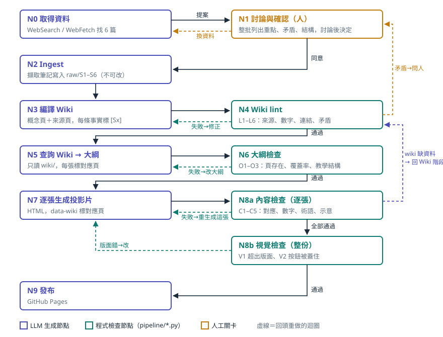
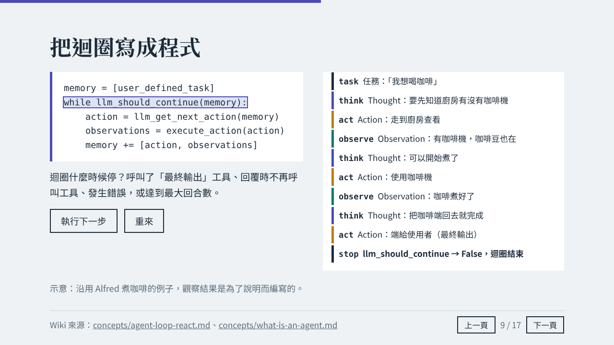

# Loop / Graph 設計與執行紀錄

## 1. 整體流程（graph）

一句話版：**取得資料 → 討論確認 → Ingest → 編譯 Wiki → lint → 查詢 Wiki 產生大綱 → 大綱檢查 → 逐張生成簡報 → 內容檢查 → 視覺檢查 → 發布**。

主幹是固定的 **prompt chaining**，每一段後面都接一個 **檢查關卡（gate）**；生成節點和檢查節點之間是 **evaluator-optimizer** 小迴圈。這兩種模式就是 Wiki 裡 [五種設計模式](../wiki/concepts/design-patterns.md) 的第 1 和第 5 種。

| 節點 | 誰做 | 輸入 → 輸出 | 檢查／重做條件 |
|---|---|---|---|
| N0 取得資料 | LLM（WebSearch、WebFetch） | 主題 → 候選來源清單 | 讀不到的來源淘汰 |
| N1 討論與確認 | **人**（我） | 重點、矛盾、結構 → 同意／修正 | 不同意就回 N0 換資料 |
| N2 Ingest | LLM | 來源 → `raw/S1–S6.md` | raw 寫入後不可改 |
| N3 編譯 Wiki | LLM | raw → 概念頁、來源頁、index、log | 每條事實都要標 `[Sx]` |
| N4 Wiki lint | 程式 `lint_wiki.py` | wiki → 錯誤清單 | L1 缺來源、L2 來源不符、L3 壞連結、L4 孤兒頁、L5 數字不在 raw、L6 矛盾沒記 log |
| N5 查詢 → 大綱 | LLM（只能讀 wiki/） | wiki → `slides/outline.md` | 每張標對應 wiki 頁 |
| N6 大綱檢查 | 程式 `check_outline.py` | 大綱 → 錯誤清單 | O1 頁存在、O2 概念頁全覆蓋、O3 教學結構完整 |
| N7 逐張生成 | LLM | 大綱＋wiki → `slides/index.html` | 每張 `data-wiki` 標對應頁 |
| N8a 內容檢查 | 程式 `check_slides.py --only N` | 投影片 → 錯誤清單 | C1 對應頁存在、C2 與大綱一致、C3 數字、C4 術語、C5 示意標註、C6 術語門檻（第二輪新增） |
| N8b 視覺檢查 | 程式 `check_visual.py`（無頭 Chrome） | 整份簡報 → 截圖＋錯誤清單 | V1 內容超出版面、V2 按鈕被蓋住 |
| N9 發布 | 人 | 檔案 → GitHub Pages | — |

## 2. 哪些步驟會重複執行？

- **N3 ⇄ N4**：每 ingest 一篇就跑一次 lint，直到 0 錯誤。之後只要改了 wiki（包括 log）都要再跑。
- **N5 ⇄ N6**：大綱沒通過就改大綱，不進入生成。
- **N7 ⇄ N8a**：逐張生成、逐張檢查，沒過就只重生成那一張。
- **N8b → N7**：整份完成後的版面問題，回去改版面。
- **檢視簡報 → N1**（第二輪討論）：簡報初稿完成後，以「新手看不看得懂」再討論一次，結論回到 Wiki 與大綱。
- **N8a → N3**（缺口迴圈）：投影片需要 wiki 沒有的內容時，**不准直接寫進簡報**，要先回 Wiki 補資料、重跑 lint。這樣「查詢的結果會累積回 Wiki」，也就是 LLM Wiki 和一般 RAG 的差別。

## 3. 哪些地方需要檢查或重新生成？為什麼這樣設計？

- **來源矛盾 → 交給人（N4 → N1）**：LLM 自己挑一個版本寫最危險，因為看起來很合理，卻沒人知道它挑過。所以矛盾一律寫進「⚠ 矛盾與註記」，由我討論後決定。
- **數字與術語 → 交給程式（L5、C3、C4）**：捏造的數字、從外面混進來的名詞，LLM 自己檢查不可靠（Wiki 的 [挑戰頁](../wiki/concepts/challenges.md) 提到「LLM 不一定能評估自己」）。所以這兩項用字串比對，機械地追到 raw。
- **對應關係 → 寫在資料裡**：Wiki 每條事實有 `[Sx]`，簡報每張有 `data-wiki`，形成 **raw → wiki → 簡報** 一條可追溯的鏈，檢查才能自動化。
- **檢查器本身也要測**：每個檢查器都先用「故意植入的錯誤」測過，確定抓得到才採信它的 0 錯誤。

## 4. 實際執行紀錄（2026-11-23）

完整原始報告在 [`pipeline/reports/`](../pipeline/reports/)，Wiki 端的時間線在 [`wiki/log.md`](../wiki/log.md)。

| 次序 | 節點 | 結果 | 發現的問題 | 處理 |
|---|---|---|---|---|
| 1 | N1 討論 | 提出 2 個問題 | S1 的代理程度表標 multi-step agent ★★★，但 S1 自稱表格取自 S2，S2 原文是 ★★☆；S5 註明工具已改變 | 我決定以 S2 為準並註記；S5 只取概念 |
| 2 | N4 lint 第 1 次 | 18 頁、111 條事實，**1 錯** | L6：矛盾有記在 log，但沒寫是哪一頁 | 在 log 補上頁面連結 |
| — | 檢查器自我測試 | 植入 4 錯，**抓到 4 個** | — | 確認 lint 有效 |
| 3 | N4 lint 第 2 次 | **0 錯** | — | — |
| 4 | N6 大綱第 1 次 | 17 張，**0 錯** | — | — |
| 5 | N8a 內容第 1 次 | **19 錯** | 18 個「借用沒宣告的頁」（第 2、9、17 張）；1 個**捏造**：測驗選項「修 bug 的程式助理」wiki 裡沒有 | 補齊對應頁（大綱同步改）；選項換成 wiki 有的「開工單、完成交易的客服機器人」 |
| 6 | N8a 內容第 2 次 | **0 錯** | — | — |
| 7 | 視覺第 1 次（臨時腳本） | **11 個問題** | 17 張中 10 張超出版面；第 9 張的說明文字蓋住「執行下一步」按鈕，點不到；導覽按鈕蓋住頁碼 | 縮小字級與邊距、導覽移進頁尾、記憶區可捲動 |
| — | 新增 N8b 並自我測試 | 植入超出版面與蓋住按鈕，**都抓到** | — | 確認 V1、V2 有效 |
| 8 | N8b 視覺第 2 次 | **0 錯** | — | — |
| 9 | N8a 第 3、4 次、N4 lint 第 3 次 | **0 錯** | 改版面與 log 後的回歸檢查 | — |
| 10 | 人工看截圖 | **2 個問題** | 檢查器沒抓到：測驗答錯的按鈕在滑鼠停留時文字變白、看不見；第 16 張頁尾太長，把翻頁按鈕擠成兩行 | 修正樣式後重跑 N8a、N8b（run5、run4）：0 錯。這兩類（文字對比、元素被擠壓）目前仍要靠人看截圖 |
| 11 | 第二輪討論：檢視簡報初稿 | **5 張卡關、3 個結構問題** | 以「新手看不看得懂」為標準：術語沒解釋（第 1、5、8、14、15 張）、一次給三套構造說法、主題順序不清、第 9 張程式沒有 Thought | 決定先補 Wiki 再改簡報；第 9 張原始程式不動、改加註解 |
| 12 | 回查原始資料 | **1 個建議被否決** | 建議把第 8 張寫成「家務與網購任務」，但原始資料只說是文字遊戲和網頁操作 | 以原始資料為準 |
| 13 | 缺口迴圈 N8a → N3 | 補 Wiki | 新增術語小辭典、更新 4 個概念頁、raw 追加補充擷取；lint 加 L7 | lint 第 5 次：19 頁、124 條事實，**0 錯** |
| 14 | 新增 C6 後跑**修改前**的簡報 | **7 錯** | 和討論找到的問題吻合；但第 8、15 張的專有名詞抓不到 | 改用人工處理 |
| 15 | 修改後 N8a、N8b | 1 錯＋1 錯 | 第 15 張「防呆」沒有括號說明；第 12 張加中文名稱後超出版面；另發現 C6 逐張模式的 bug | 都修正；最後 0 錯 |

截圖：完成後的第 9 張（互動迴圈跑完）

